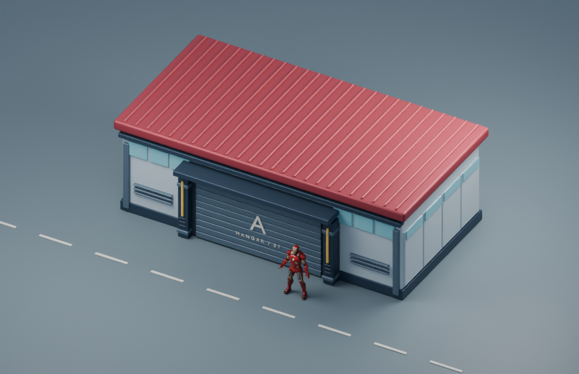

# Base Avengers · maqueta de escala 01

Abrir `hangar.glb` en Blender o en el visor de GLB del proyecto. La fachada mide 10 m y el techo llega a 3,52 m. El origen está en el centro de la huella a nivel de suelo. Las piezas conservan sus nombres y materiales para editar la fachada, el portón, la cubierta y las guías laterales.

La escena de estudio usa el Mark VII a 1,88 m como referencia. El GLB contiene el edificio. La carretera y el personaje se añaden sólo al render de escala. La prueba de oclusión en el mapa jugable queda para la integración. `acceso-tres-cuartos.png` muestra la pieza lateral aislada para valorar futuras variantes.

Para reproducir desde la raíz: `blender-launcher.exe -b --factory-startup --python-exit-code 1 --python scripts/blender/base_avengers_hangar.py`. El script vuelve a exportar el modelo y sus tres vistas.
