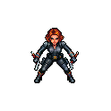
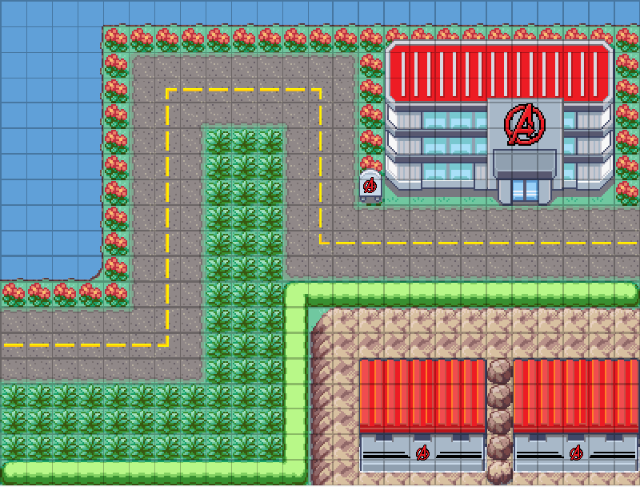

# Black Widow y el hangar de la Base Avengers

**Decisiones confirmadas.** El primer conjunto reúne a Black Widow y un hangar de la Base Avengers. La dirección es cómic cinematográfico, con proporciones de película, siluetas claras y materiales simplificados. Trabajaremos sobre la primera misión de los cuatro mapas actuales.

## Referencias del juego original

| Black Widow | Base de los Vengadores |
| --- | --- |
|  |  |

El sprite aporta el pelo cobrizo, el traje oscuro y la postura de combate. El mapa aporta techos rojos acanalados, fachada gris, vidrio celeste, un acceso ancho y la avenida con jardines. Usar el [Mark VII existente](../art/models/iron-man-mark-vii-v1/preview.png) como referencia de escala y contraste al juntar ambos héroes en la escena.

## Diseño propuesto

**Black Widow.** La cabeza de pelo cobrizo y la separación entre brazos y torso tienen que leerse desde arriba. Reservar tres masas de color para el cuerpo: traje grafito mate, guanteletes de metal más claro y hebilla roja. En primer plano, distinguir tejido de metal por el reflejo. Desde la cámara de partida, reconocerla por el pelo y las muñecas aunque desaparezcan las costuras. Preparar una vista frontal de cuerpo entero en pose A y una vista trasera coherente para revisión en Blender. Modelar accesorios empuñados por separado para que los dedos puedan cerrar y la muñeca pueda girar al disparar.

**Hangar.** La forma principal es un volumen bajo y ancho con portón retraído. Ensayar una proporción de fachada de tres anchos por uno de alto. Reservar el rojo para la cubierta acanalada y el emblema, con hormigón gris claro y una franja horizontal de vidrio celeste bajo el alero. En Blender, separar techo, fachada y portón para poder repetir módulos y variar su ancho. Construir la geometría recta y el emblema allí. Usar Meshy para explorar una pieza singular, como la carcasa lateral del acceso. En la prueba de cámara, ubicar el edificio sobre una huella decorativa del mapa, manteniendo visible el tramo de avenida que pasa por delante.

**Prueba conjunta.** Colocar a Widow sobre una zona válida junto al hangar y a Iron Man cerca para comparar escalas. Capturar una vista táctica con enemigos y una vista cercana a tres cuartos. A tamaño de juego deben distinguirse el pelo, las manos y el límite del camino. En la vista cercana, revisar espalda, dedos, hombros y alineación de pies. Si el rojo del techo compite con el pelo, bajar primero la saturación y el brillo del techo.

## Orden de producción y uso de créditos

1. Preparar dos referencias aisladas: cuerpo entero de Widow sobre fondo neutro y vista a tres cuartos de una pieza del acceso. Validar la fachada con volúmenes a escala. El sprite y la captura del mapa sirven para dirigir la estética.
2. Generar primero la malla de Widow. Revisar cara, manos, pelo por detrás y separación de brazos en Blender antes de pagar el rig. Si pasa, probar reposo, apuntado y disparo. Conservar créditos de iteración para fallas identificadas en una vista concreta.
3. Evaluar el hangar a escala de la cámara de combate. Generar la pieza singular si mejora la entrada. Encajarla en la fachada modular y congelar escala y pivotes. Reutilizar módulos en las otras fachadas de la Base.
4. Guardar referencias en `art/references/` y candidatos versionados en `art/models/`. Revisar primero en `art-studio.html`. Al integrar, extender la carga de héroes en `src/render/hero-assets.js` y vestir la misión en `src/render/battle-map.js`. Comprobar la ruta, las casillas de despliegue, la escala junto al Mark VII y la respuesta del navegador con varias unidades; ejecutar las pruebas del proyecto.

**Presupuesto de referencia.** Saldo consultado de 1.065 créditos. En la primera producción, Mark VII costó 30 por generación y 5 por rig. Con esos costes históricos, una malla de Widow, su rig y una pieza estática sumarían 65 créditos. Es una estimación para un intento por pieza. Verificar el coste efectivo antes de producir. Esta fase cubre diseño y preparación.
